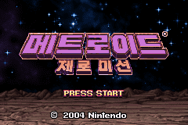

# 메트로이드 제로 미션 — 게임보이 어드밴스

게임보이 어드밴스 **메트로이드 제로 미션** 한글 번역 패치 프로젝트입니다. 사무스가 행성을 탐험하며 장비와 능력을 얻는 액션 어드벤처 게임입니다.

> **최종 배포본 · 2026-08-24**

<!-- game-preview:start -->

  

**한글 타이틀** — title_ko Mesen 캡처
<!-- game-preview:end -->

## 다운로드 및 적용 방법

1. 아래 체크섬 또는 상세 안내와 일치하는 원본을 준비합니다.
2. [최종 배포 패치 다운로드](https://github.com/akuma815/gba-metroid-zero-mission-kr-patch/releases/tag/release-20260824)에서 ZIP을 받아 모두 압축 해제합니다.
3. 원본 ROM 또는 ISO를 동봉 `apply.cmd`에 끌어다 놓습니다.
4. 생성된 한글판 파일의 SHA-256을 확인하고 실행합니다.

## 주의사항

- 일본판 BMXJ 전용입니다.
- 패치 이전 세이브에서 일부 지도 지역명의 마지막 글자가 빠질 수 있습니다.
- 링크 케이블 관련 화면의 실기 검증은 미실시입니다.
- 원본 게임·BIOS 및 패치가 적용된 게임 이미지는 포함하지 않습니다.

## 체크섬

| 구분 | SHA-256 |
| --- | --- |
| 패치 파일 `MetroidZeroMission_KR_20260824.xdelta` | `bfd3f85da26d4be7eaaabbde18a2d7fc4684a3ec96fec6c7fb830114ca33edf2` |
| 원본 JP | `d087ca6e2d1808109a579c2283e944d81c8426d37de564f99ea9273087c2172a` |
| 패치 후 이미지 JP | `944d2eee3afa7c407624e4c810f48c1ed69e310b5e1c9c58f2aee8091aa97d57` |
| 배포 압축 파일 | `913c6b55a9df323c0762588cc21e7e1c331424f8322705e774973c0707185b52` |

지원 원본의 세트·리비전 및 해시는 [상세 패치 안내](docs/PATCH_GUIDE.txt)를 확인하세요.

## 소스 및 작업 기록

[공개 소스 구성과 빌드 전제](docs/SOURCE_GUIDE.md) · [상세 패치 안내](docs/PATCH_GUIDE.txt)
